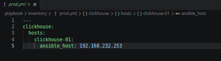
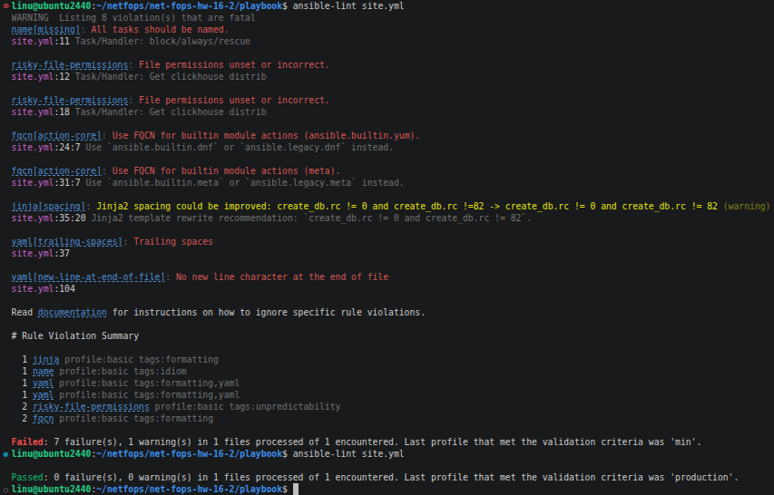
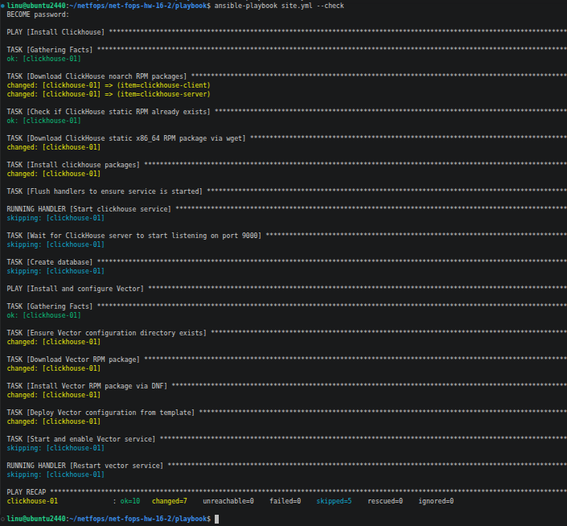
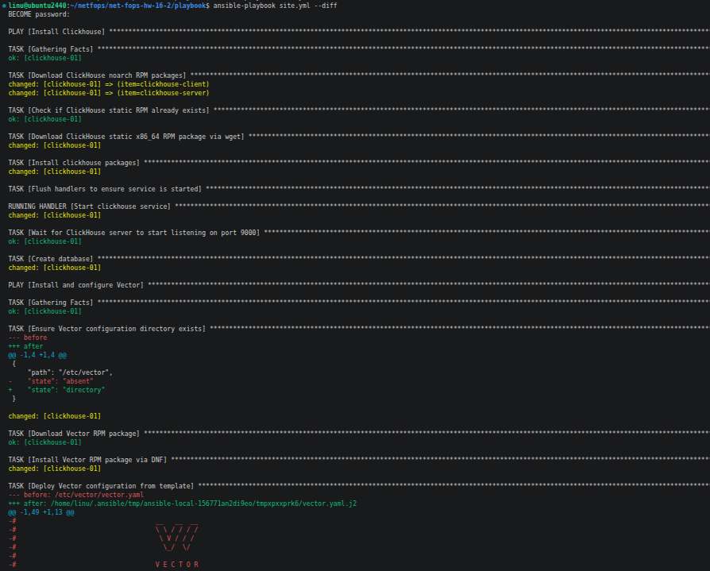
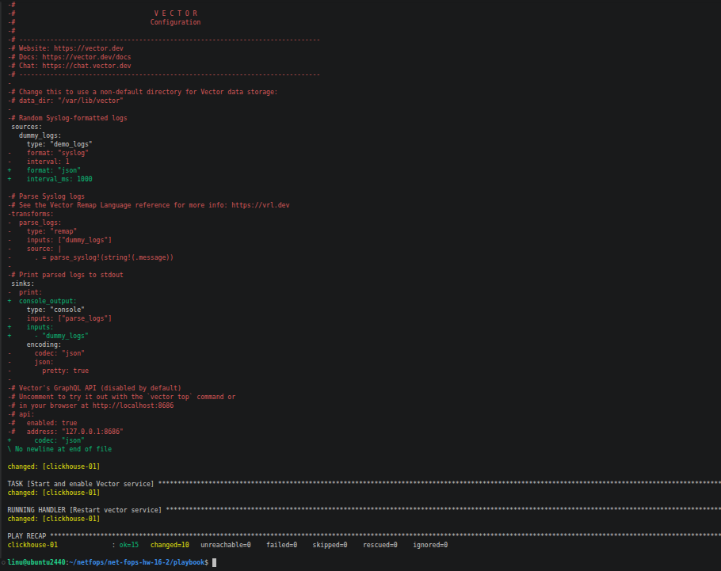
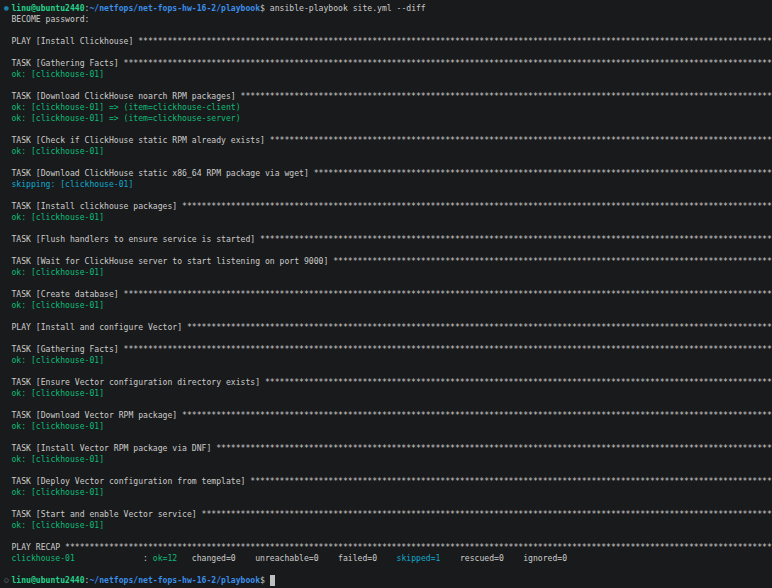

# Домашнее задание к занятию 2 «Работа с Playbook» - Розаев А.Ю.

## Подготовка к выполнению

1. Изучено, что такое [ClickHouse](https://www.youtube.com/watch?v=fjTNS2zkeBs) и [Vector](https://www.youtube.com/watch?v=CgEhyffisLY).
2. Создан публичный репозиторий на GitHub.
3. Скачан [Playbook](./playbook/) из репозитория с домашним заданием и перенесен в созданный репозиторий.
4. Подготовлен хост в соответствии с группами из предподготовленного playbook.

## Основная часть

1. Подготовлен inventory-файл `prod.yml`.



2. Дополнен playbook: дописан еще один play, который устанавливает и настраивает [vector](https://vector.dev). Конфигурация vector деплоится через template файл jinja2. Создан handler на перезапуск vector в случае изменения конфигурации.
3. При создании tasks использованы модули: `get_url`, `template`, `file`.
4. Tasks выполняют: скачивание дистрибутива нужной версии, копировние в выбранную директорию, установку vector.
5. Произведен запуск `ansible-lint site.yml` и исправлены ошибки.



6. Произведен запуск playbook с флагом `--check`.



7. Произведен запуск playbook на `prod.yml` окружении с флагом `--diff`.





8. Повторно запущен playbook с флагом `--diff`, подтверждена идемпотентность.



9. Подготовлен README.md-файл с описанием, что делает playbook, какие у него есть параметры и теги.

[Documentation](https://github.com/expgt/net-fops-hw-16-2/blob/main/16_2_1.png)

10. Готовый playbook выложен в созданный репозиторий, поставлен тег `08-ansible-02-playbook` на фиксирующий коммит.


-----


# Ansible Playbook: ClickHouse & Vector Deployment

Данный Playbook предназначен для автоматизированного развертывания, настройки и запуска СУБД ClickHouse и агента сбора логов Vector на серверах под управлением операционных систем семейства RedHat (Rocky Linux 8/9, AlmaLinux 8/9).

## Оглавление
1. [Описание работы плейбука](#описание-работы-плейбука)
2. [Структура проекта](#структура-проекта)
3. [Требования к окружению](#требования-к-окружению)
4. [Входные параметры (Переменные)](#входные-параметры-переменные)
5. [Теги (Tags)](#теги-tags)
6. [Инструкция по запуску](#инструкция-по-запуску)

---

## Описание работы плейбука

Плейбук разделен на два независимых сценария (Play):

### Play 1: Install ClickHouse
* Скачивает официальные дистрибутивы ClickHouse (`client`, `server`) в формате RPM-пакетов.
* Скачивает пакет `clickhouse-common-static` с помощью системной утилиты `wget`.
* Устанавливает пакеты локально через менеджер пакетов `dnf` с отключением проверки GPG-подписей.
* Запускает и активирует службу `clickhouse-server`.
* Ожидает инициализации сервера и открытия сетевого порта `9000`.
* Создает базу данных `logs` (если она еще не создана).

### Play 2: Install and configure Vector
* Создает необходимые системные директории для конфигурации агента.
* Скачивает официальный RPM-пакет Vector.
* Выполняет установку пакета в операционную систему.
* Деплоит конфигурационный файл `/etc/vector/vector.yaml` из Jinja2-шаблона.
* Настраивает автоматический запуск (Enabling) и стартует службу `vector`.
* Содержит обработчик (Handler), который автоматически перезапускает службу Vector при любом изменении Jinja2-шаблона конфигурации.

---

## Структура проекта

```text
.
├── ansible.cfg                      # Глобальные настройки Ansible
├── site.yml                         # Основной файл плейбука
├── inventory/                       # Директория с файлами инвентаря
│   └── prod.yml                     # Файл inventory
└── templates/                       # Директория шаблонов
│   └── vector.yaml.j2               # Шаблон конфигурационного файла
└── group_vars/clickhouse/           # Директория переменных
               ├── vars.yml          # Основные переменные
               └── vault.yml         # Секрет для уз
```

---

## Требования к окружению

* Управляющий узел: Ansible версии `2.21+` и `ansible-lint 26.11.0+`.
* Целевые хосты: Операционная система Rocky Linux 8/9 или AlmaLinux 8/9.
* Интерпретатор на хостах: Установленный пакет `python39` (путь к бинарнику: `/usr/bin/python3.9`).
* Права доступа: Подключение по SSH под пользователем с возможностью повышения прав до `root` (`sudo`).

---

## Входные параметры (Переменные)

Переменные конфигурации могут быть переопределены в файле инвентаря (`hosts.yml`) или в `group_vars/clickhouse/vars.yml`.

| Имя переменной | Значение по умолчанию | Описание |
| :--- | :--- | :--- |
| `clickhouse_version` | *Обязательный параметр* | Строгая версия устанавливаемых пакетов ClickHouse (например, `"22.3.3.44"`). |
| `vector_version` | `"0.43.0"` | Версия агента Vector для скачивания из репозитория Datadog. |
| `vector_config_dir` | `"/etc/vector"` | Путь на удаленном сервере, куда будет развернута конфигурация Vector. |
| `ansible_python_interpreter` | `"/usr/bin/python3.9"` | Путь к современному интерпретатору Python на целевом хосте. |

---

## Теги (Tags)

Для запуска отдельных частей инфраструктуры к сценариям привязаны следующие теги:

*   `clickhouse` — запуск только первого сценария: скачивание, установка СУБД ClickHouse и создание базы данных.
*   `vector` — запуск только второго сценария: скачивание RPM-пакета, деплой Jinja2-шаблонов и запуск службы сбора логов.

*Пример запуска только настройки Vector:*
```bash
ansible-playbook site.yml --tags "vector"
```

---

## Инструкция по запуску

1. Режим проверки (Check Mode)
```bash
ansible-playbook site.yml --check
```

2. Боевой запуск плейбука (с выводом изменений конфигураций):
```bash
ansible-playbook site.yml --diff
```
